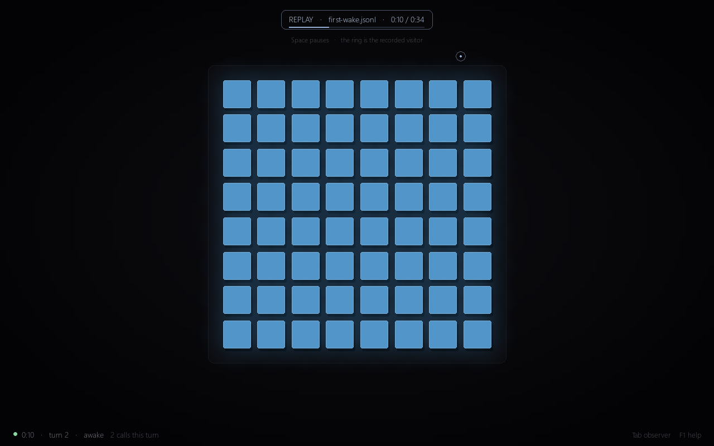

# The virtual lab

The first stage of [A body to wake up in](../README.md): a simulated 8×8 body of pins, a person played by mouse and keyboard, a mind that wakes inside the body without being told what it is, and a script that measures what it does.



*Ten seconds into the first live session. The mind has turned itself blue and is answering "hello" with a slow swell of every pin.*

## Run it

You need [uv](https://docs.astral.sh/uv/). It fetches Python and the three packages the lab uses.

| | Install uv |
|---|---|
| Windows | `winget install --id=astral-sh.uv -e` |
| macOS, Linux | `curl -LsSf https://astral.sh/uv/install.sh \| sh` |

Then, in this folder:

```
uv run python main.py
```

To wake a mind, copy `.env.example` to `.env` and put your Anthropic API key after `ANTHROPIC_API_KEY=`. The file stays on your machine and is ignored by git.

Without a key the room still opens, and says plainly that no mind is connected. Two things work with no key:

- `uv run python main.py --replay docs/first-wake.jsonl` plays back the first live session, 34 seconds long: a real mind, with a scripted visitor standing in for the person. Press Tab to read what it thought.
- `uv run python main.py --dry-run` runs the whole loop with a scripted stand-in. It is a wiring test, labelled on screen as not an AI, and the analysis never counts it.

## In a web page

The same lab runs in a browser, from `web/`: **[ai-dan-web.vercel.app](https://ai-dan-web.vercel.app)**. It is a port to plain JavaScript, not a lookalike. Every desktop session log replays there to the same body states, and a log downloaded from the page passes `--verify` and `lab.analyze` here. `web/ARCHITECTURE.md` explains how.

- **Watch the first waking** replays `docs/first-wake.jsonl`. No key needed.
- **Wake a mind** needs the visitor's own Anthropic API key. The key goes from their browser straight to api.anthropic.com and is not stored. If the host turns on the access-code mode, a visitor with the code can use the host's key instead.
- **Wiring test** is the scripted stand-in. **Open a session log** replays any `.jsonl`.

It is hosted on Vercel's free tier. The project's Root Directory is `ai-dan/web`, there is no build step, and every push to `main` deploys. To run it locally, serve the folder: `cd web` then `python -m http.server`. Its tests need Node: `cd web` then `npm test`.

The access-code mode is off by default. To turn it on, set both `ANTHROPIC_API_KEY` and `LAB_ACCESS_CODE` in the Vercel project's environment variables, then redeploy. Every session then runs on that key. `api/mind.js` forwards only this lab's prompt, tools, settings and conversation shape, but anyone with the code can still spend the key. Share the code only with people you trust, and set a spend limit on the key in the Anthropic Console.

## In the room

| You | How |
|---|---|
| Arrive | Move the mouse into the window. The session and its clock start here. |
| Touch | Hold the mouse button down on a pin. It sinks while you push. |
| Speak | Type, then press Enter. |
| Leave | Move the mouse out of the window. |

| Key | |
|---|---|
| Tab | Observer panel: the mind's thoughts and calls. Hidden by default, because the person in the room is not meant to see them. |
| F1 | Help |
| F2 | Hide all text, for clean recordings |
| F11 | Fullscreen |
| Esc | Quit |

The mind wakes when you arrive, when you speak, when you leave, and every 12 seconds while you are there. Each wake hands it one bare line, the time and anything you said, and four tools: `play`, `stop`, `sense`, `set_color`. A touch does not wake it. It has to notice the touch itself, as a pin that is not where it was told to be.

Nothing on screen moves unless the body's state says so. A pin's brightness is its real height and nothing else.

## Commands

| Command | What it does |
|---|---|
| `uv run python main.py` | A live session. Writes `sessions/<date>_<time>.jsonl`. |
| `uv run python main.py --memory` | Later-days mode: the mind gets `remember` and reads the note it left last time. |
| `uv run python main.py --model NAME` | Wake a different model. |
| `uv run python main.py --dry-run` | The scripted wiring test. |
| `uv run python main.py --replay FILE [--speed N]` | Watch a session again. Space pauses. |
| `uv run python main.py --verify FILE` | Replay with no window and check that the body ends up in the same states. |
| `uv run python -m lab.analyze [FILES or FOLDERS]` | The success criterion from `mind.md`, computed from logs. Defaults to `sessions/`. |
| `uv run python -m lab.shot all shots/` | Render the window's canned scenes to PNG. |
| `uv run pytest` | The tests. |

Any parameter in `lab/config.py` can be set in `.env` as `LAB_<NAME>`, for example `LAB_PULSE_S=8`. Every session records all of them in its first log line.

## Run the experiment

`mind.md` asks for 10 first-day sessions with the same configuration, the person following the same script each time.

1. Run `uv run python main.py` ten times. Follow the script in `mind.md` and let each session end by itself, at 40 turns or 15 minutes.
2. Run `uv run python -m lab.analyze`.

A session counts only if it had a live mind, memory was off, the model answered at least once, and it ran to its own limit. Sessions with identical configuration, prompt and model form a batch, and the reading (emerges consistently, sometimes, or not) is given for a batch of exactly 10. The script lists candidates for the two observations that need a human reader, with their line numbers in the log, and leaves the yes or no to you.

Token use for each session is in its log and in the analysis output. For scale, the 34-second first session used 21,637 input and 896 output tokens.

## How it is built

```
person ── mouse, keyboard ──▶ app.py ── 50 ticks a second ──▶ world.py ──▶ simbody.py
                                                                 ▲              │
mind ── harness.py ◀── wakes ── events ──────────────────────────┤         nervous.py
          │                                                      │         display.py
          └── tool calls, applied on the next tick ──────────────┘         contract.py
```

| File | Spec | What it is |
|---|---|---|
| `main.py` | | The entry point |
| `lab/display.py` | `shape-display.md` | Pins, speed limit, response delay, touch, deviation trace |
| `lab/nervous.py` | `nervous-system.md` | Tracks to ordered heights; plain loops, written to be ported to the board |
| `lab/contract.py` | `body-contract.md` | The four tools, validation, error messages |
| `lab/simbody.py` | | The three above behind one object |
| `lab/mind.py` | `mind.md` | The prompt, the tool definitions, the note |
| `lab/model.py` | `harness.md` | The Claude client, and the scripted stand-in |
| `lab/harness.py` | `harness.md` | Wakes, turns, in-session memory, limits |
| `lab/world.py` | | Glue between the window thread and the mind thread; replay |
| `lab/log.py` | `harness.md` | One file per session, one line per event |
| `lab/analyze.py` | `mind.md` | The success criterion |
| `lab/render.py`, `lab/app.py` | `shape-display.md` | The window |
| `lab/config.py` | all | Every parameter from every spec |

`ARCHITECTURE.md` has the interfaces, the log format and the decisions made where the specs were open. Some tests compare the prompt and tool descriptions word for word with the specs, so they expect the spec files one folder up.

## What has been checked

- 215 tests pass, including one for each acceptance criterion in the body specs.
- Three live sessions with `claude-sonnet-5-5`, 23 turns in all, ran without an API error. One used fast pulses, early fading of old `sense` results and the `remember` tool, to exercise the paths most likely to break.
- Every logged session, live ones included, replays to identical body states. A tampered log is caught.
- An independent review compared the code with the specs. Its findings were fixed and are covered by tests.

Not checked yet:

- A full-length session, to 40 turns or 15 minutes.
- A person at the mouse in a live session. The live tests used a scripted visitor.
- Fullscreen and resizing in a real window.

## Where the code differs from the specs

Each of these is a default to confirm or overturn.

| Topic | Spec | Code | Why |
|---|---|---|---|
| Output cap | `MAX_TOKENS` 1024 | 4096 | Thinking cannot be switched off on `claude-sonnet-5-5` and counts toward the cap. At 1024 a tool call could be cut off mid-way. |
| Model settings | "a current Claude Sonnet" | `claude-sonnet-5-5`, adaptive thinking, effort `low` | Low effort keeps turns short enough for a body that runs in real time. Both are in `config.py`. |
| Monologue | The model's text | Text plus the summaries of its thinking | On this model, longer notes between tool calls arrive as thinking, so text alone would lose them. |
| Memory of past turns | Text and calls kept | Thinking is turned into text once a turn is over | The API rejects replayed thinking blocks after earlier turns change, and fading old `sense` results changes them. |
| Recent turns in full | "The last 6 turns" | 6 finished turns plus the one in progress | The spec can be read either way. |
| Calls past the cap | Not specified | Not run; answered "That is too much for one moment." | Every call needs an answer, and the turn must stop at 8. |
| Cut-off response | Not specified | None of its calls are run; same answer as above | A half-written call can still parse as a smaller movement the mind did not order. |
| `sense.person` | "position in pin units" | `[row, column]`, one decimal | Same order as a pin's name. |
| Tool schemas | "the shape of a track" | Field names and types only | No height range, grid size or caps reach the mind. |
| Refusals | Not specified | Logged, turn skipped, no fallback model | A session should be one model throughout. |
| Setup | A venv, numpy, pygame | uv, no numpy, `pygame-ce` | uv makes it one command. 64 pins do not need numpy. `pygame-ce` is the maintained fork and has builds for Python 3.14. |
| 30 seconds of motion | "keep that motion for 30 seconds" | Must be in the log, counted from when each pin's track starts | A session that ends early has not shown it. |

One finding about the specs themselves: shape-display criterion 2 says a full-range oscillation faster than 1 cycle per second "never reaches the extremes". A pin that starts at 0 does return to 0. The test checks that it never reaches 1 and that the swing stays under half the range.
